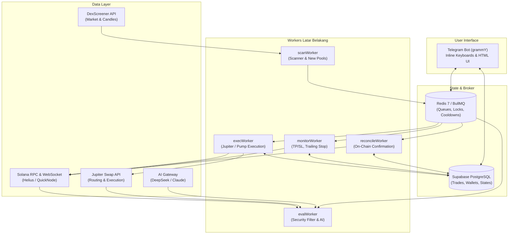

# 🚀 Solana Scalping Telegram Bot & Autopilot

[](https://nodejs.org/)
[](https://www.typescriptlang.org/)
[](https://solana.com/)
[](docker-compose.yml)
[](https://bullmq.io/)
[](https://vitest.dev/)
[](LICENSE)

Bot Telegram *institutional-grade* untuk trading, scalping, dan eksekusi otomatis (*autopilot*) di jaringan Solana. Dibangun dengan fokus utama pada keandalan eksekusi, keamanan dana tingkat tinggi (AES-256-GCM), filter anti-rug berlapis, analisa teknikal AI tanpa halusinasi, antrean asynchronous terdistribusi BullMQ, dan antarmuka Telegram interaktif tanpa spam.

---

## 📑 Daftar Isi
1. [Fitur Utama](#-fitur-utama)
2. [Arsitektur Sistem & Data Flow](#-arsitektur-sistem--data-flow)
3. [Daftar API & Layanan Eksternal](#-daftar-api--layanan-eksternal)
4. [Tech Stack](#-tech-stack)
5. [Struktur Direktori Proyek](#-struktur-direktori-proyek)
6. [Prasyarat Sistem](#-prasyarat-sistem)
7. [Panduan Instalasi & Konfigurasi](#-panduan-instalasi--konfigurasi)
8. [Panduan Menjalankan Bot](#-panduan-menjalankan-bot)
9. [Navigasi & Perintah Bot Telegram](#-navigasi--perintah-bot-telegram)
10. [Panduan Menu & Tombol Interaktif](#-panduan-menu--tombol-interaktif)
11. [Multi-Engine Autopilot & Sniper](#-multi-engine-autopilot--sniper)
12. [Filter Anti-Rug & Keamanan On-Chain](#-filter-anti-rug--keamanan-on-chain)
13. [Sistem Kriptografi & Dompet](#-sistem-kriptografi--dompet)
14. [Testing & Verifikasi Kualitas](#-testing--verifikasi-kualitas)
15. [Troubleshooting & FAQ](#-troubleshooting--faq)
16. [Disclaimer & Keamanan Finansial](#-disclaimer--keamanan-finansial)

---

## 🌟 Fitur Utama

### 1. 🛡️ Filter Anti-Rug & Honeypot Ketat (Multi-Layer)
- **Status Otoritas On-Chain**: Memverifikasi secara langsung bahwa *Mint Authority* dan *Freeze Authority* telah di-revoke/dinonaktifkan.
- **Deteksi Ekstensi Token-2022 Berbahaya**: Memindai ekstensi berbahaya seperti `transferFeeConfig` (pajak tersembunyi), `permanentDelegate` (otoritas backdoor), dan `defaultAccountState`.
- **Simulasi Jual & Honeypot**: Melakukan quote swap balik dan simulasi on-chain melalui RPC `simulateTransaction` untuk mendeteksi token yang tidak bisa dijual atau memiliki slippage tidak wajar.
- **Analisis Konsentrasi Top 10 Holder**: Menghitung porsi kepemilikan dompet teratas secara cerdas dengan mengecualikan pool likuiditas (Raydium, Orca, Meteora), vault staking, dan alamat burn agar tidak terjadi *false positive hard-block*.
- **Skor Keamanan Dinamis (0–100)**: Perhitungan skor risiko komprehensif dengan aturan **Hard-Block** otomatis untuk kriteria kritis.

### 2. 🧠 Analisa AI Scalping Real-time Tanpa Halusinasi
- **Indikator Matematika Murni**: Data teknikal dihitung secara deterministik (EMA 9/21, RSI 14, ATR 14, Volume Spike Ratio, Liquidity-to-FDV).
- **LLM Gateway Fleksibel**: Kompatibel dengan model OpenAI-compatible (DeepSeek v4 Flash, Qwen) dan Anthropic Claude.
- **Validasi Output Zod Terstruktur**: Respon AI dipaksa dalam format JSON schema yang divalidasi ketat oleh Zod, mengeliminasi halusinasi harga atau sinyal palsu.
- **Dynamic TP/SL**: Level Take Profit dan Stop Loss dihitung adaptif berdasarkan volatilitas nyata pasar (ATR).

### 3. 🚀 Multi-Engine Autopilot: Trending, Sniper, & Copy Trade
- **Trending Scalper**: Memindai token trending bervolume tinggi dari DexScreener dan mengeksekusi order saat konfluensi teknikal terpenuhi.
- **New Token Sniper**: Mendeteksi peluncuran pool baru secara instan, mengevaluasi umur likuiditas, dan melakukan snipe dengan proteksi floor market terukur.
- **Copy Trading**: Melacak dompet target yang dikonfigurasi pengguna dengan pembuktian signature sumber (`source proof`) dan eksekusi instan.
- **Strategy Reservations**: Alokasi kuota modal dan saldo di database untuk mencegah tabrakan saldo (*race condition*) antar mesin yang berjalan simultan.
- **Exit Policy Engine**: Eksekusi penutupan posisi bertahap (TP1, TP2, partial close) dengan trailing stop loss dinamis.

### 4. ⚡ Presisi Eksekusi & Routing Jupiter
- **Presisi Eksak Lamports (`solToLamports`)**: Mengonversi pecahan SOL ke lamport secara presisi tanpa kehilangan 1 lamport akibat floating point truncation (`Math.floor`).
- **Dynamic Slippage & Priority Fee**: Menghitung slippage berdasarkan price impact likuiditas serta menentukan gas priority fee dari persentil ke-75 transaksi jaringan terkini.
- **Per-Order Idempotency Keys**: Setiap order memiliki hash idempotensi unik sehingga pesanan berulang dalam menit yang sama tidak mengalami tabrakan atau duplikasi.
- **Paper Trading vs Live Trading**: Mode simulasi default (*dry-run*) menggunakan harga real-time tanpa menyentuh dana asli hingga pengguna secara sadar mengaktifkan mode Live.

### 5. 💳 Dompet Terenkripsi & Proteksi Penarikan
- **Enkripsi AES-256-GCM**: Private key dienkripsi menggunakan kunci master 32-byte, IV 12-byte unik, dan Authentication Tag 16-byte dengan Additional Authenticated Data (AAD) yang mengikat `user_id` ke ciphertext.
- **Protected Withdrawal**: Dana hanya dapat ditarik ke alamat Solana yang telah didaftarkan (`/set_withdraw_address`), dilengkapi mekanisme *cooldown* keamanan 24 jam setelah perubahan alamat.
- **Reclaim Rent Lamports**: Fitur `/claim_rent` untuk menutup Token Account kosong yang tidak lagi digunakan dan menarik kembali SOL sewa rent ke saldo utama.

### 6. 📱 UX Telegram Responsif & PnL Card Generator
- **Auto-Detect CA**: Cukup tempel Contract Address (CA) token di obrolan tanpa perlu mengetik perintah.
- **Clean In-Place Updates**: Mengedit pesan yang sama secara langsung guna mencegah banjir spam obrolan.
- **Generator Kartu PnL**: Menghasilkan kartu gambar grafis performa profit/loss yang menarik untuk dibagikan ke media sosial.

---

## 🏛️ Arsitektur Sistem & Data Flow



---

## 🔌 Daftar API & Layanan Eksternal

| Layanan | Peran Utama | Metode / Integrasi | Keterangan & Rekomendasi |
|---|---|---|---|
| **Solana RPC** | Query saldo, inspeksi on-chain, simulasi tx, broadcast | `@solana/web3.js` (HTTP + WSS) | Disarankan menggunakan provider berbayar seperti **Helius**, **QuickNode**, atau **Triton** untuk latensi rendah |
| **Jupiter API** | Quote swap, build transaction, kalkulasi rute terbaik | `@jup-ag/api` (v6) | Digunakan untuk swap WSOL ⇄ SPL Token |
| **PumpPortal** | Fast swap khusus bonding curve Pump.fun | REST API PumpPortal | Digunakan otomatis untuk token mint berakhiran `pump` |
| **DexScreener API** | Data candle harga, volume transaksi, likuiditas | HTTPS REST API | Mengambil data live pair dan candle scalping |
| **DeepSeek / OpenAI API** | Evaluasi setup trading & analisis konfluensi pasar | HTTPS REST API (`/v1/chat/completions`) | Format output terstruktur via Zod schema |
| **Supabase (PostgreSQL)** | Penyimpanan data pengguna, dompet, posisi, dan log | `@supabase/supabase-js` v2.49+ | Memanfaatkan RLS, trigger, dan fungsi PostgreSQL |
| **Redis 7** | Antrean BullMQ, distributed lock, cooldown limiter | `ioredis` | Self-hosted via Docker container |

---

## 🛠️ Tech Stack

- **Runtime**: Node.js v22+ LTS *(Membutuhkan native WebSocket)*
- **Bahasa**: TypeScript 5.7+
- **Framework Bot**: `grammy` v1.35+
- **Blockchain**: `@solana/web3.js`, `@solana/spl-token`, `@jup-ag/api`, `bs58`
- **Database**: Supabase (`@supabase/supabase-js`) & PostgreSQL 15+
- **Queue & Lock**: BullMQ v5+, `ioredis`
- **Kriptografi**: Node.js `crypto` bawaan (AES-256-GCM)
- **Image Processing**: `@resvg/resvg-js`, `qrcode`
- **Validasi Data**: `zod`
- **Logging**: `pino`, `pino-pretty`
- **Pengujian**: `vitest` v3.2+, Node.js Native Test Runner

---

## 📂 Struktur Direktori Proyek

```
solana-scalping/
├── .dockerignore                  # File yang diabaikan saat build Docker
├── .env.example                   # Template konfigurasi environment variables
├── .gitignore                     # Aturan ignore file git
├── Dockerfile                     # Multi-stage build container Node.js 22 Alpine
├── docker-compose.yml             # Konfigurasi orkestrasi Bot + Redis
├── package.json                   # Dependensi npm dan script otomasi
├── tsconfig.json                  # Konfigurasi compiler TypeScript
├── vitest.config.ts               # Konfigurasi test runner Vitest
│
├── supabase/
│   └── migrations/                # Skrip migrasi DDL PostgreSQL berurutan
│       ├── 001_initial_schema.sql
│       ├── ...                    # Migrasi bertahap fitur keamanan, kuota, & rekonsiliasi
│       ├── 040_copy_trade_source_proof.sql
│       ├── 20261011161605_transaction_integrity_hardening.sql
│       └── 20261012011700_fix_exit_reconcile_v_attempt.sql
│
├── src/
│   ├── index.ts                   # Entrypoint aplikasi, bootstrap worker, & graceful shutdown
│   ├── config/                    # Manajemen konfigurasi terpusat & validasi env Zod
│   ├── database/                  # Client Supabase & class repository (User, Trade, Wallet, dll.)
│   ├── queue/                     # Setup koneksi Redis, antrean BullMQ, dan worker prosesor
│   │   ├── connection.ts
│   │   ├── queues.ts
│   │   └── workers/               # Scan, Eval, Exec, Monitor, Reconcile, SecureDelete
│   ├── modules/
│   │   ├── analyzer/              # Indikator teknikal (RSI, EMA, ATR) & LLM Gateway
│   │   ├── autopilot/             # Engine autopilot, risk manager, & circuit breaker
│   │   ├── copytrade/             # Tracker dompet copy trading & proof verifier
│   │   ├── scanner/               # Scanner token trending & sniper likuiditas baru
│   │   ├── security/              # Anti-rug validator, Token-2022, & analyzer konsentrasi holder
│   │   ├── telegram/              # Router command Telegram, handler tombol, & formatter pesan
│   │   ├── trader/                # Eksekusi order, routing Jupiter/Pump, fee, & rekonsiliasi
│   │   ├── user/                  # Layanan state akun & statistik pengguna
│   │   └── wallet/                # Enkripsi AES-256-GCM, manajemen saldo, & validasi transfer
│   └── utils/                     # Logger Pino, currency service, & custom error class
│
├── scripts/                       # Skrip audit mutu kode & guard check
│   ├── grep-guards.mjs            # Static code analysis untuk guard transaksi
│   └── mutation-check.mjs         # Mutation verification runner
│
└── tests/
    ├── native/                    # Regression test runner native Node.js
    ├── integration/               # Test siklus hidup bot & end-to-end flow
    └── unit/                      # 35+ test suite untuk tiap modul secara terisolasi
```

---

## 📋 Prasyarat Sistem

Pastikan lingkungan server atau mesin lokal Anda memenuhi spesifikasi berikut:
1. **Node.js**: Versi `22.0.0` atau lebih tinggi (`node -v`).
2. **NPM**: Versi `10.0.0` atau lebih tinggi (`npm -v`).
3. **Docker & Docker Compose**: Untuk menjalankan Redis dan kontainer aplikasi secara terisolasi.
4. **Proyek Supabase**: Akun Supabase (cloud gratis atau self-hosted PostgreSQL).
5. **Bot Telegram**: Token bot resmi dari [@BotFather](https://t.me/BotFather).
6. **Solana RPC**: Akses RPC HTTP & WebSocket (misal Helius, QuickNode, atau Alchemy).

---

## ⚙️ Panduan Instalasi & Konfigurasi

### 1. Kloning Repository
```bash
git clone https://github.com/kennedys0/potential-carnival.git
cd potential-carnival
```

### 2. Pasang Dependensi
```bash
npm install
```

### 3. Konfigurasi Environment Variables
Salin file `.env.example` ke `.env`:
```bash
cp .env.example .env
```

Buka file `.env` lalu sesuaikan nilainya:

```env
# Mode Lingkungan (development | production | test)
NODE_ENV=development

# Telegram Bot Token dari @BotFather
TELEGRAM_BOT_TOKEN=123456789:ABCdefGhIJKlmNoPQRsTUVwxyZ

# Hak Akses Pengguna (Pisahkan dengan koma jika lebih dari satu ID)
ADMIN_USER_IDS=5390732859
WHITELISTED_USERS=5390732859

# Solana RPC Endpoints (Disarankan Helius / QuickNode untuk live trading)
SOLANA_RPC_URL=https://mainnet.helius-rpc.com/?api-key=YOUR_API_KEY
SOLANA_WSS_URL=wss://mainnet.helius-rpc.com/?api-key=YOUR_API_KEY

# Kredensial Database Supabase (PostgreSQL)
SUPABASE_URL=https://your-project.supabase.co
SUPABASE_SERVICE_ROLE_KEY=eyJh...YOUR_SERVICE_ROLE_KEY

# Master Encryption Key (Wajib 64 Karakter Hex = 32 Bytes)
# Buat dengan: node -e "console.log(require('crypto').randomBytes(32).toString('hex'))"
MASTER_ENCRYPTION_KEY=0123456789abcdef0123456789abcdef0123456789abcdef0123456789abcdef

# Koneksi Redis untuk BullMQ & Distributed Locks
REDIS_URL=redis://127.0.0.1:6379

# Konfigurasi AI Gateway (DeepSeek / OpenAI Compatible)
AI_BASE_URL=https://api.deepseek.com/v1
AI_API_KEY=sk-your-deepseek-api-key
AI_MODEL=deepseek-chat

# Mode Trading: false = PAPER TRADING (Simulasi), true = LIVE TRADING (Dana Nyata)
LIVE_TRADING_ENABLED=false

# Fitur Ekspor Private Key (false secara default demi keamanan)
PRIVATE_KEY_EXPORT_ENABLED=false
```

> [!CAUTION]
> **JANGAN PERNAH** membagikan atau mengunggah `MASTER_ENCRYPTION_KEY` ke repository publik. Kunci ini digunakan untuk mengenkripsi seluruh private key dompet pengguna di database.

### 4. Eksekusi Migrasi Database di Supabase
1. Buka dashboard proyek Supabase Anda.
2. Masuk ke tab **SQL Editor**.
3. Jalankan file-file SQL di direktori `supabase/migrations/` secara berurutan sesuai urutan penomoran (mulai dari `001_initial_schema.sql` hingga migrasi terbaru).

---

## 🚀 Panduan Menjalankan Bot

### Opsi A: Menjalankan via Docker Compose (Rekomendasi Produksi)
Docker Compose secara otomatis menyiapkan kontainer Redis dan kontainer aplikasi bot:

```bash
# 1. Jalankan container di background dengan rebuild
docker compose up -d --build

# 2. Cek log output bot secara real-time
docker compose logs -f bot

# 3. Menghentikan bot
docker compose down
```

### Opsi B: Menjalankan Secara Lokal (Development)

1. Jalankan instance Redis via Docker:
   ```bash
   docker run -d --name local-redis -p 6379:6379 redis:7-alpine
   ```
2. Jalankan bot dalam mode watch (auto-restart saat ada perubahan kode):
   ```bash
   npm run dev
   ```

---

## 📱 Navigasi & Perintah Bot Telegram

Bot mendukung perintah teks maupun navigasi tombol visual:

| Perintah | Deskripsi Fungsi |
|---|---|
| `/start` | Mendaftarkan akun, menginisialisasi dompet terenkripsi, dan menampilkan menu utama. |
| `/dashboard` | Menampilkan ringkasan portofolio: saldo SOL, posisi aktif, PnL hari ini, dan status engine. |
| `/wallet` | Membuka manajemen dompet: alamat deposit monospace, QR code, cek saldo, dan penarikan. |
| `/scan <CA>` | Memindai token Solana secara mendalam (analisis anti-rug + sinyal AI scalping). |
| `[Kirim Alamat CA]` | **Auto-detect**: Cukup tempelkan alamat mint token (32–44 karakter base58) langsung di chat. |
| `/autopilot` | Membuka kontrol Autopilot (Trending Scalper & New Token Sniper). |
| `/positions` | Memantau daftar posisi terbuka, PnL berjalan, partial exit, dan generate kartu PnL. |
| `/settings` | Konfigurasi bot: ganti mode (Paper / Live), ukuran order SOL, dan strategi exit. |
| `/set_withdraw_address <CA>` | Mendaftarkan alamat penarikan eksklusif (mengaktifkan cooldown proteksi 24 jam). |
| `/withdraw [JUMLAH|MAX]` | Menarik SOL ke alamat penarikan yang telah didaftarkan. |
| `/claim_rent` | Menutup Token Account yang sudah kosong (saldo 0) dan menarik kembali SOL sewa rent. |
| `/copy` | Membuka menu Copy Trading dan konfigurasi dompet target. |
| `/report` | Menampilkan laporan performa trading harian dan akumulasi realized PnL. |
| `/killswitch <on|off>` | *(Khusus Admin)* Mematikan atau menghidupkan seluruh entry order secara instan dalam keadaan darurat. |
| `/help` | Menampilkan panduan komprehensif panduan bot dan kebijakan proteksi modal. |

---

## 🎛️ Panduan Menu & Tombol Interaktif

### 🏠 Menu Utama (`/start` / `/dashboard`)
- **🔍 Scan Token**: Petunjuk instan memindai token baru.
- **💳 Wallet & Deposit**: Tampilan alamat dompet, tombol refresh saldo, dan QR code.
- **🤖 Autopilot**: Kontrol on/off mesin otomatis dan pengaturan risiko.
- **📊 Positions**: Mengelola posisi trading aktif (Close 50%, Close 100%, PnL Card).
- **⚙️ Settings**: Konfigurasi parameter trading dan mode operasi.
- **❓ Bantuan**: Dokumentasi panduan lengkap.

### ⚙️ Pengaturan Trading (`/settings`)
- **🟢 Beralih ke LIVE / 🟡 Beralih ke PAPER**: Beralih mode trading instan.
- **🛡️ Konservatif / ⚖️ Moderat / ⚡ Agresif**: Penggantian preset risiko cepat.
- **💰 Trade Size**: Mengubah besaran pembelian per order (misal `0.05 SOL`, `0.1 SOL`, `0.25 SOL`, atau custom).
- **🎯 Exit Strategy**: Mengatur persentase Take Profit, Stop Loss, dan aktivasi Trailing Stop.

### 💳 Manajemen Dompet (`/wallet`)
- **🔄 Refresh Saldo**: Melakukan query RPC on-chain terkini secara langsung.
- **💸 Withdraw**: Membuka antarmuka penarikan dana ke dompet pribadi.
- **🏷️ Claim Rent**: Menutup token account kosong untuk mendapatkan refund sewa ~0.002 SOL per account.
- **🔑 Export Private Key**: Menampilkan private key (hanya jika fitur diizinkan oleh admin).

---

## 🤖 Multi-Engine Autopilot & Sniper

Bot dilengkapi tiga mesin trading otomatis yang dapat beroperasi secara independen:

### 1. Trending Scalper Engine
- Mengambil kandidat token dari filter volume dan likuiditas DexScreener.
- Menganalisis indikator moving average (EMA 9/21 cross), Relative Strength Index (RSI), dan Average True Range (ATR).
- Mengharuskan konfluensi positif dari LLM Analyzer sebelum mengeksekusi order.

### 2. New Token Sniper Engine
- Memantau pembentukan liquidity pool baru secara real-time.
- Memeriksa batas umur pool minimum (misal 20 detik) dan maksimum (misal 5 menit) untuk menyaring instan-rug.
- Menerapkan parameter exit khusus volatilitas tinggi (take profit agresif tanpa trailing lambat).

### 3. Copy Trading Engine
- Memantau transaksi on-chain dari alamat dompet target (*smart money*).
- Memvalidasi keaslian signature sumber transaksi (`copy_source_signature`) sebelum membuat pesanan cermin.
- Menyesuaikan ukuran transaksi dengan batas modal yang ditentukan pengguna.

### 4. Circuit Breaker & Manajemen Risiko
- **Batas Rugi Harian (`maxDailyLossSol`)**: Jika total kerugian trading mencapai ambang batas harian, Autopilot otomatis berhenti hingga pergantian hari.
- **Batas Kekalahan Beruntun (`maxConsecutiveLosses`)**: Mencegah trade berulang dalam kondisi pasar buruk dengan menonaktifkan autopilot sementara.
- **Global Kill-Switch**: Operator bot dapat mematikan seluruh aktivitas beli di seluruh sistem melalui perintah `/killswitch on`.

---

## 🛡️ Filter Anti-Rug & Keamanan On-Chain

Setiap token yang dipindai (baik manual maupun otomatis) wajib melewati rangkaian gerbang keamanan:

```
[Token Candidate]
       │
       ▼
[Gerbang 1: Otoritas On-Chain] ──► Gagal (Mint/Freeze aktif) ──► ❌ HARD BLOCK (Skor 0)
       │ Lolos
       ▼
[Gerbang 2: Token-2022 Extensions] ──► Gagal (Fee/Delegate backdoor) ──► ❌ HARD BLOCK (Skor 0)
       │ Lolos
       ▼
[Gerbang 3: Simulasi Swap Jual] ──► Gagal (Tax > 10% / Gagal Jual) ──► ❌ HARD BLOCK (Skor 0)
       │ Lolos
       ▼
[Gerbang 4: Konsentrasi Top 10 Holder] ──► > 30% di luar LP/Burn ──► ⚠️ Skor Berkurang Drastis
       │ Lolos
       ▼
[Gerbang 5: Likuiditas & Volume Pasar] ──► Likuiditas terlalu tipis ──► ⚠️ Penalti Risiko
       │
       ▼
[Perhitungan Skor Akhir: 0 - 100]
```

> [!NOTE]
> Filter konsentrasi holder mengecualikan Raydium AMM Pool, Orca Whirlpools, Meteora Vaults, dan alamat Burn (`11111111111111111111111111111111`, `dead...`) agar tidak menimbulkan *false positive* saat pool likuiditas memegang suplai besar.

---

## 🔒 Sistem Kriptografi & Dompet

1. **Enkripsi Kunci Privat**:
   - Algoritma: **AES-256-GCM** dengan autentikasi integritas data (*authenticated encryption*).
   - Setiap enkripsi menggunakan IV (Initialization Vector) 12-byte acak dan menghasilkan 16-byte authentication tag.
   - Menggunakan Additional Authenticated Data (AAD) yang mengikat `user_id` dan public key ke ciphertext, sehingga ciphertext tidak dapat ditukar atau dipindahkan antar baris database.

2. **Isolasi Kunci Master**:
   - `MASTER_ENCRYPTION_KEY` hanya dibaca dari environment memory dan tidak pernah disimpan ke database atau dikirim ke Telegram.

3. **Kebijakan Penarikan Terkunci (Locked Withdrawal)**:
   - Pengguna mendaftarkan alamat dompet tujuan mereka menggunakan `/set_withdraw_address`.
   - Perubahan alamat penarikan memicu *cooldown* keamanan 24 jam sebelum penarikan berikutnya diizinkan, melindungi dana pengguna jika akun Telegram sempat terkompromi.

---

## 🧪 Testing & Verifikasi Kualitas

Seluruh fungsionalitas bot dilindungi oleh test suite yang komprehensif:

```bash
# Menjalankan seluruh test suite Vitest
npm test

# Menjalankan verifikasi lengkap (Type check + Vitest + Native test + Guard checks)
npm run verify

# Menjalankan verifikasi penuh dengan mutation checks
npm run verify:full
```

Semua 229 unit & integration tests saat ini **100% lulus**, mencakup:
- Presisi konversi lamport tanpa truncation floating point.
- Uniknya kunci idempotensi pesanan per-transaksi.
- Proteksi partial exit dan pemulihan rekonsiliasi saat crash on-chain.
- Filter Token-2022 dan simulasi swap anti-honeypot.
- Autentikasi dan binding ciphertext enkripsi dompet.

---

## ❓ Troubleshooting & FAQ

### 1. Error: `Saldo SOL tidak cukup. Balance: ... Req: ... + 0.005 (safety fee)`
- **Penyebab**: Transaksi memerlukan saldo cadangan minimal 0.005 SOL untuk biaya gas jaringan, pembuatan token account, dan prioritas fee.
- **Solusi**: Sisakan minimal 0.01 SOL di dalam dompet sebelum melakukan trade.

### 2. Error: `Native WebSocket not found`
- **Penyebab**: Supabase JS v2.49+ memerlukan runtime Node.js yang memiliki implementasi native WebSocket.
- **Solusi**: Gunakan Node.js 22 LTS atau jalankan bot melalui Docker (`docker compose up -d`).

### 3. Error: `Penarikan Ditangguhkan! Alamat penarikan Anda baru saja diubah`
- **Penyebab**: Fitur keamanan cooldown 24 jam sedang aktif setelah Anda mengganti alamat penarikan.
- **Solusi**: Tunggu hingga masa cooldown berakhir demi keamanan proteksi akun Anda.

### 4. Trade berstatus `RESERVED` atau `PENDING`
- **Penyebab**: Transaksi sedang menunggu konfirmasi on-chain dari validator Solana.
- **Solusi**: Background worker `reconcileWorker` akan memeriksa status signature secara otomatis dan menyelesaikan status trade tanpa intervensi manual.

---

## ⚠️ Disclaimer & Keamanan Finansial

Aplikasi ini dirancang untuk tujuan edukasi, riset kuantitatif, dan otomatisasi trading pribadi. Pasar aset kripto (khususnya memecoin dan token mikro di jaringan Solana) memiliki tingkat volatilitas ekstrem serta risiko kerugian modal yang sangat tinggi. 

Pengembang dan kontributor proyek ini **tidak bertanggung jawab** atas kerugian finansial, kegagalan transaksi jaringan, atau kerugian yang ditimbulkan akibat penggunaan bot ini. Selalu gunakan mode **Paper Trading** terlebih dahulu untuk menguji strategi Anda. **Do Your Own Research (DYOR)** dan kelola risiko secara bijak.
